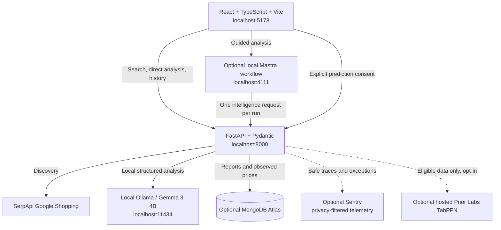

# RivalIQ

**Evidence-linked competitor intelligence for small e-commerce sellers.**

Built for the Hacktoberfest Week 2 challenge. RivalIQ combines real shopping
listings, conservative product matching and local AI analysis to help sellers
review their own pricing and positioning. It does not fabricate competitor data
or claim to calculate a guaranteed optimal selling price.

## Features

- Discover product listings and alternative competitors through SerpApi Google Shopping.
- Distinguish estimated identical products, variants, comparable alternatives and uncertain matches.
- Calculate like-for-like price comparisons in Python; keep broader market observations separate.
- Generate cited local Gemma reports with seller-directed recommendation checks and disclosed deterministic guidance when needed.
- Save and reopen reports with optional MongoDB Atlas persistence.
- Run optional Mastra guided workflows with validated steps, progress and seller action briefs.
- Explore experimental hosted TabPFN pricing only with sufficient real data and explicit cloud-processing consent.
- Keep privacy-filtered Sentry backend observability and local timing diagnostics.

## Architecture and stack



FastAPI is the source of truth for discovery, matching, Decimal price calculations,
Gemma analysis, persistence and prediction. Mastra adds validated orchestration
and deterministic report mapping; it does not add another LLM or repeat provider
calls. No hosted Mastra account or API key is required. Everything can run locally
except the explicitly configured provider integrations.

| Layer | Technology |
| --- | --- |
| Web interface | React, TypeScript, Vite |
| API and validation | Python, FastAPI, Pydantic |
| Discovery | SerpApi Google Shopping |
| Local intelligence | Ollama with `gemma3:4b` |
| Optional orchestration | Open-source Mastra TypeScript workflows, Node HTTP server, Zod |
| Optional storage | MongoDB Atlas through official PyMongo |
| Optional observability | Sentry Python SDK |
| Optional predictive pricing | Official `tabpfn-client`, hosted Prior Labs regression API |

Competitor discovery and local Gemma intelligence for small e-commerce sellers. Includes React product search, evidence-linked intelligence, optional MongoDB Atlas history, Sentry backend observability, experimental hosted TabPFN pricing estimates and optional local Mastra workflow orchestration. No demand forecasting, Render deployment or additional website scraping is implemented.

## Requirements and setup

- Node.js 22.13+ and npm (24.19 verified); Python 3.11+. Mastra requires Node 22.13 or newer.
- A SerpApi account with available Google Shopping search credits and an API key.
- For intelligence only: local Ollama with `gemma3:4b`. Existing product search works without Ollama.
- Run commands from the repository root. On Windows PowerShell use `npm.cmd` if script execution policy blocks `npm`.

```powershell
npm.cmd install
python -m venv .venv
.\.venv\Scripts\python.exe -m pip install -r backend/requirements-dev.txt
if (-not (Test-Path backend/.env)) { Copy-Item backend/.env.example backend/.env }
```

Set `SERPAPI_API_KEY=your_key` in `backend/.env`. Never put it in frontend code or commit `.env`. Existing environment variables take precedence. Restart the API after changing `.env`.

If `.env` already exists, preserve the existing key and add these optional settings (shown defaults):

```dotenv
OLLAMA_URL=http://localhost:11434
OLLAMA_MODEL=gemma3:4b
OLLAMA_TIMEOUT_SECONDS=180
```

Core dependencies include the official `pymongo` async driver and `sentry-sdk`. Update the existing virtual environment with `.\.venv\Scripts\python.exe -m pip install -r backend/requirements-dev.txt`. Hosted pricing has a separate optional SDK installation described below. No new frontend dependencies are required.

Start the API in one terminal:

```powershell
.\.venv\Scripts\python.exe -m uvicorn app.main:app --app-dir backend --reload --host 127.0.0.1 --port 8000
```

Start Vite in another terminal:

```powershell
npm.cmd run dev
```

Open http://localhost:5173. API docs: http://127.0.0.1:8000/docs. Vite proxies `/api` to port 8000; CORS also allows the local Vite origins. Production static hosting needs reverse proxies for `/api` and `/orchestration`; the development proxy is not deployed.

On macOS/Linux use `npm`, `.venv/bin/python`, and `cp backend/.env.example backend/.env` instead.

## Optional Mastra guided analysis (Milestone 5)

The existing direct analysis button remains unchanged. To enable **Run guided analysis**,
copy `orchestration/.env.example` to `orchestration/.env` if it does not already exist,
then run `npm.cmd run dev:orchestration` in a third terminal. Default port: **4111**.
No Mastra account or API key is needed. Configure only the server-side
`FASTAPI_BASE_URL`, `ORCHESTRATION_PORT`, `ORCHESTRATION_TIMEOUT_MS` and `CORS_ORIGIN`
there; keep provider credentials in `backend/.env`.

The official Mastra workflow validates seller details, invokes FastAPI once,
inspects evidence/comparability/save status, and maps the report into a deterministic
seller brief. React displays polled step status and a run ID. No extra LLM,
search, report write or automatic TabPFN prediction is introduced. If orchestration
fails, use the direct path explicitly after checking history for an already saved
report. Timeouts do not guarantee cancellation of work already running in FastAPI.

Milestone 5.1 adds seller-directed recommendation safety in FastAPI. Invalid
recommendations are individually replaced with labeled deterministic guidance;
valid seller advice is retained. Zero/one/small/larger comparable samples get
different evidence explanations, while primary benchmarks still require two
offers. Guided briefs show your current price, comparable evidence, actions and
uncertainties. Saved reports are checked when reopened without new provider
calls. See [seller safety policy and verification](docs/milestone-5.1-seller-safety.md).

See [architecture, PowerShell startup scripts, API contracts and operational limits](docs/milestone-5-orchestration.md)
and [actual verification results](docs/milestone-5-verification.md).

```powershell
npm.cmd run check --workspace orchestration
npm.cmd run test:orchestration
npm.cmd run build:all
.\.venv\Scripts\python.exe -m pytest backend/tests -q
# Explicit paid live workflow check, with backend + orchestration running:
.\.venv\Scripts\python.exe orchestration/scripts/smoke.py --allow-paid-searches
```

## API and data contract

- `GET /api/health` returns `{"status":"ok","service":"rivaliq-api"}`. It checks application liveness, not SerpApi connectivity.
- `POST /api/competitors/search` accepts:

```json
{"product_name":"stainless steel water bottle","market":"India","currency":"INR","max_results":5}
```

Only `product_name` is required. Defaults are India, INR, and 5. Maximum results: 1–20. Markets: India, United States, United Kingdom, Canada, Australia (case insensitive). Currency accepts INR, USD, GBP, CAD, AUD. Unknown markets/currencies and invalid inputs return 422.

The service uses SerpApi's supported `google_shopping` engine with `gl` country targeting and English results. See [SerpApi documentation](https://serpapi.com/google-shopping-api). A single provider request is made; `max_results` caps returned listings, not provider billing or pagination. No other sites are fetched.

The response is `{"competitors":[...]}`. Each entry contains `product_name`, `listed_price` (number), `currency`, `merchant`, `product_url`, `source`, UTC `retrieved_at`, and optional `features` (string list). Unknown fields remain JSON null. Product URLs can point to Google Shopping when that is the URL supplied by SerpApi.

`currency` in the request records the caller's preference; Google Shopping does not offer a guaranteed currency conversion parameter. It does not convert or relabel prices. Response currency comes only from an explicit provider currency or an unambiguous price marker. A bare `$` remains null. Numeric prices come only from nonnegative, finite `extracted_price` values; malformed or display-only prices remain null. This intentionally favors missing data over invented values.

Empty results return 200 with an empty array. Missing/rejected credentials return 503, provider rate/quota limits 429, timeout 504, and other provider or malformed-response failures 502. Provider error details are not forwarded. No automatic retries spend extra search credits.

## Gemma intelligence pipeline

`POST /api/intelligence` accepts the search fields plus required positive `selling_price` and optional nonnegative `cost`. Monetary inputs accept decimal strings or numbers, at most two decimal places and 12 digits before the decimal point. Cost may exceed selling price; negative gross margin is valid. `max_results` defaults to 5 and is limited to 1–6 **per query** to bound local-model context. Market/currency options are unchanged; the UI currently targets India/INR.

```json
{"product_name":"Milton stainless steel water bottle 1 litre","selling_price":"799.00","cost":"500.00","market":"India","currency":"INR","max_results":5}
```

1. Gemma proposes one broader, brand-independent substitute/category query. This is a discovery hypothesis, not a product specification.
2. The API searches Google Shopping for the original and broader queries: up to two SerpApi calls, with no automatic retry or pagination. Broader discovery may return alternatives, variants, identical products or unrelated results; relevant alternatives are not guaranteed.
3. Existing normalization preserves reported titles, merchants, URLs, features, prices, currency and retrieval timestamps. Every observation gets a server-assigned `L1`, `L2`, … reference and its discovery query.
4. Python conservatively flags duplicate observations by canonical URL (removing only known tracking parameters), merchant, title, reported features, price and currency. Without a URL, a matching known title/merchant and matching attributes are required. Different prices, merchants, variant parameters or attributes remain separate. Duplicates remain in `listings` with `duplicate_of` but are excluded from calculations and the model's evidence set. This does not claim to identify every duplicate.
5. Python extracts only explicitly stated attributes from source titles/features and the seller name: category, capacity (normalized to ml), material, brand, and explicitly labeled model. Known brand names and the seller's supplied brand/model are recognized only when present in listing text. Merchant names and discovery queries are never substituted for missing specifications. Conflicting attributes, capacity ranges and explicit multipacks are excluded. Missing attributes remain null. The extractor uses a deliberately small vocabulary (drinkware, backpacks, headphones/earbuds, phones; common materials/brands); unsupported or sparse products may have no primary benchmark. This is preferable to inventing specifications.
6. Attribute rules determine `identical` (explicit matching brand/model/category, no known conflicts), `variant` (same stated brand/category with attribute differences or no verified model identity), `comparable_alternative` (matching category/capacity/material), `alternative` (broader relevant match with differences), or `uncertain`. Primary eligibility requires matching category/capacity/material or matching explicit brand/model/category with no stated conflict. A different capacity or material excludes even a same-brand variant. These rules estimate comparability; they do not verify identity, authenticity or quality, and they do not account for every product attribute.
7. Python `Decimal` arithmetic computes **primary** same-currency prices only for unique eligible offers. `pricing.comparable_price_count` now means offers meeting attribute and price/currency rules. At least **two** eligible offers are required for `minimum`, `median`, `maximum`; otherwise these are null, `benchmark_status` is `insufficient`, and a server-authored explanation replaces model pricing observations. Individual factual `comparisons` may still be available for one offer. Broader sample statistics are returned separately in `market_observations`, never used to determine whether the seller is over/underpriced. Unknown currencies/prices and duplicates are excluded from both sets.
8. Seller-minus-listing differences and percentage differences relative to listing price, gross profit (`selling_price - cost`) and gross margin (`profit / selling_price × 100`) remain Python calculations. Values are rounded half-up to two decimals; unknown cost yields null profit/margin, zero listing price yields null percentage. Taxes, fees and shipping are not inferred.
9. Gemma generates market overview, advantages, threats, pricing observations and exactly three recommendations. Price advantages must cite higher-priced comparable offers; price threats must cite cheaper comparable offers. These citations are validated in Python, so a cheaper competitor cannot be cited as a seller price advantage. Unsupported quality/feature superiority is not inferred; advantages/threats may be empty. Recommendations are prompted to address the seller's stated specifications, margin or evidence gaps. Narrative accuracy still requires human review.

Ollama receives [JSON Schema structured-output requests](https://docs.ollama.com/capabilities/structured-outputs) at `/api/chat`, non-streaming, temperature 0. Two model calls remain: short discovery planning and narrative reporting. Classification is now computed in Python, saving generated tokens and preventing model overrides of benchmark eligibility. Prompts contain shortened titles and extracted attributes rather than merchant names/full features, compact JSON, relevant Python metrics and eligible source IDs. Findings are prompted to stay under 24 words. Output budgets are 100 discovery / 1,800 report tokens (formerly 160 / 2,500); truncated responses still fail validation. Full normalized listing data stays in the response. Retrieved/user strings remain untrusted; no model tools or URL fetching are enabled.

Pydantic validates both model responses, disallows extra fields and enforces exactly three recommendations. The generation schema also constrains source IDs and requires empty advantage/threat arrays when there are no eligible supporting offers. The server independently validates these citations and assembles one classification per unique listing. URLs and merchant/price facts are assembled by the server, never supplied by Gemma. The React report renders optional seller attributes, primary vs broader market figures, source classifications/exclusions, duplicate flags, original URLs, timings and caveats. Model text remains plain text.

Existing fields remain: `model`, `queries`, `listings`, `duplicate_count`, `pricing`, `report`, `caveats`. Additions: `seller_attributes`, `market_observations`, `performance`, listing `attributes`/`comparability`, and pricing benchmark status/message/minimum requirement. The legacy `report.classifications[].category` enum remains unchanged: comparable alternatives map to `alternative` there; the richer category is in `listings[].comparability.category`. Pricing aggregates intentionally have stricter semantics. Decimal values serialize as strings. The existing product-search contract is unchanged.

The request may include optional known seller specifications; the UI also exposes these in a disclosure below the product form:

```json
{"product_name":"Milton bottle","selling_price":"799.00","seller_attributes":{"category":"bottle","capacity_ml":"1000","material":"stainless steel","brand":"Milton"}}
```

Use canonical category/material names from the UI. Explicit attributes conflicting with the seller's name disable primary matching instead of silently replacing the conflicting information.

Failures are explicit: 404 for no listings across both queries; 422 for invalid seller input; 503 for missing search credentials, unreachable Ollama, missing model or invalid Ollama configuration; 504 for either provider timing out; 429 for SerpApi rate/quota limits; 502 for other provider failures, invalid model JSON/schema, truncated output, invalid references or unsupported price claims. Failed discovery or either search aborts analysis. No report or fabricated fallback is substituted. Failed requests may already have consumed search credits. Product search remains independently available.

## Test intelligence locally (PowerShell)

Check your existing installation and download the model only if absent:

```powershell
ollama list
ollama pull gemma3:4b
```

If the Ollama app/server is not running, run `ollama serve` in its own terminal. Avoid starting a second server if port 11434 is already occupied by Ollama. If `ollama` is not on PATH, use its installed executable path or restart the terminal after installation.

Start the API and Vite using the commands above, then use **Generate intelligence report** at http://localhost:5173, or call the API directly:

```powershell
$body = @{
  product_name = 'Milton stainless steel water bottle 1 litre'
  selling_price = '799.00'
  cost = '500.00'
  market = 'India'
  currency = 'INR'
  max_results = 5
} | ConvertTo-Json
Invoke-RestMethod -Method Post -Uri 'http://127.0.0.1:8000/api/intelligence' -ContentType 'application/json' -Body $body -TimeoutSec 420 | ConvertTo-Json -Depth 20
```

Local generation can take several minutes on a CPU, including cold model loading. `OLLAMA_TIMEOUT_SECONDS` applies to each model call (1–600 seconds); if you raise it, increase your API client's timeout accordingly. The UI has no artificial short analysis timeout. If the response is 502 for model output, retry explicitly or simplify the product name; a syntactically valid model response can still be rejected for invalid sources or unsupported price claims. Check original search separately at `/api/competitors/search` if SerpApi fails.

## Performance diagnosis

Every intelligence response includes `performance.total_ms`, a random request ID and per-stage measurements. SerpApi stages measure actual elapsed request/normalization time. Ollama stages include wall time and, when returned by Ollama, model total/load/prompt-evaluation/generation durations, token counts and generation tokens/second. Nanosecond metadata is converted to milliseconds; omitted or invalid metadata stays null. These sub-durations are inside Ollama wall time, **not additional durations to sum with it**. Queueing/transport overhead can account for differences. No separate service, streaming, model preload or automatic retry was added.

`performance.total_ms` measures server analysis orchestration including output validation. HTTP middleware separately logs handler time (including validation/serialization, excluding browser/network transfer) and exposes `Server-Timing: app;dur=...`. Successful responses include `X-RivalIQ-Request-ID`. Timing and HTTP logs use the same server-generated ID. Logs under `uvicorn.error` contain only IDs, fixed stage names, status/outcome, durations and token counts—no API keys, prompts, product text, URLs or provider exception strings. Failure stages and request totals are logged too.

The UI shows an elapsed-time loading indicator rather than invented stage progress; completed reports expose a timing table. To reproduce one live diagnostic without launching the frontend or FastAPI server:

```powershell
.\.venv\Scripts\python.exe backend/scripts/benchmark_intelligence.py
```

This explicitly uses up to two SerpApi searches and local Gemma; it is outside pytest. It prints only timing metadata, counts and benchmark status. Optional flags: `--product`, `--selling-price`, `--cost`, `--max-results` (1–6). Model load times depend on whether Ollama already has the model resident; one run does not establish cold-start or sustained-throughput performance.

The recorded warm-model live check completed in 35.49 seconds; generation accounted for about 95% of analysis time. See [measured timing breakdown](docs/milestone-2.1-performance.md) for the sample, caveats and reproduction command.

## MongoDB Atlas persistence

Persistence is optional. Add these to your existing `backend/.env` without replacing other settings:

```dotenv
MONGODB_URI=mongodb+srv://<database-user>:<encoded-password>@<cluster-host>/?retryWrites=true&w=majority
MONGODB_DATABASE=rivaliq
```

In Atlas, create a cluster and a database user with read/write access to the chosen database. Add the backend machine's public IP to the cluster's network access list. Copy the Python driver connection URI, replace its placeholders, and percent-encode special characters in the username/password. Credentials belong only in the backend environment. Use `MONGODB_URI=` to disable persistence. Restart the backend after changing configuration.

One application-scoped PyMongo `AsyncMongoClient` is shared by all requests and closed on application shutdown. There is no startup ping requirement or index-creation privilege: history sorting uses MongoDB's built-in `_id` index. Server selection/connect timeouts are 3 seconds and overall database operations are bounded to 5 seconds. A failed database connection does not stop application startup or prevent analysis.

Successful `POST /api/intelligence` analyses are inserted into `<MONGODB_DATABASE>.reports` as versioned snapshots: UTC creation time, typed seller inputs, all normalized listings and source references, derived classifications/attributes, primary and broader pricing, model recommendations, caveats and analysis performance metadata. Monetary decimals remain exact JSON strings; document creation time is a native BSON UTC datetime. Only application report fields are serialized—never settings, prompts, API keys, MongoDB credentials or the Sentry DSN. Known credentials and credential-bearing URL components are scrubbed before storage.

The existing analysis response retains its fields and adds:

```json
{"persistence":{"status":"saved","report_id":"<24-hex-id>","saved_at":"<UTC timestamp>","message":"Report saved.","elapsed_ms":120.5}}
```

When MongoDB is absent, status is `disabled` and the UI explicitly says saving is unavailable. If saving fails, status is `error`, ID stays null, and the completed analysis is still returned with HTTP 200. A save failure never silently reruns SerpApi or Gemma. The snapshot contains analysis timings; write elapsed time is measured after insertion and exposed separately in the current response and local persistence logs. HTTP total time includes persistence.

- `GET /api/reports?limit=10&offset=0`: lightweight `reports` summaries plus `next_offset` (null at the end). Limit 1–50, offset 0–10000, newest ObjectId first. MongoDB projects only the stored summary; full listings and AI text are not loaded for history cards.
- `GET /api/reports/{report_id}`: `{id, created_at, schema_version, seller_inputs, intelligence}`. A complete snapshot is returned without provider calls. Invalid ObjectIds return 422, unknown IDs 404, database/configuration failures 503. Error messages never expose the connection URI.

The responsive history section can refresh, paginate and reopen snapshots using the same report renderer as new analysis. Citation anchors are scoped separately so history and live reports can coexist. A snapshot reflects its original retrieval time; reopening does not refresh market prices. History is currently shared by the deployment; user authentication and tenant isolation have not been added in this milestone.

To check the live API after generating a report:

```powershell
$history = Invoke-RestMethod 'http://127.0.0.1:8000/api/reports?limit=10'
$history.reports
if ($history.reports.Count -gt 0) {
  $id = $history.reports[0].id
  Invoke-RestMethod "http://127.0.0.1:8000/api/reports/$id" | ConvertTo-Json -Depth 30
}
```

## Sentry backend observability

Create a Python/FastAPI project in Sentry and copy its DSN into `backend/.env`:

```dotenv
SENTRY_DSN=
SENTRY_TRACES_SAMPLE_RATE=0.1
```

An empty DSN disables Sentry initialization, spans, exception capture and shutdown flushing. A configured DSN enables FastAPI/Starlette exception capture and sampled request transactions. Use sample rate `1.0` temporarily for a local verification; `0.1` samples 10% of performance transactions. Invalid configuration disables Sentry with a generic local warning rather than preventing startup. Errors are captured independently of the transaction sampling rate.

Manual spans instrument `serpapi.discovery`, `gemma.discovery`, `gemma.analysis`, `mongodb.save`, `mongodb.list` and `mongodb.get`. Default/automatic HTTPX, MongoDB, AI and logging integrations are deliberately disabled. Sentry data collection disables bodies, headers/cookies, query parameters, user identity, database query data, AI inputs/outputs, frame locals and source context. Outbound error/transaction hooks additionally allowlist route templates, fixed stage descriptions, trace IDs/timestamps and exception stack locations; they remove exception messages, request/user data, prompts, descriptions, URLs, breadcrumbs, arbitrary tags/extras and span payload data. Full product and customer data are not sent to Sentry. Local timing diagnostics remain available independently.

The SDK flushes briefly on application shutdown. The tests use an in-memory Sentry transport to verify real FastAPI exception capture and all named span types, including payload redaction, without network delivery. Milestone 4 adds `mongodb.observations.save`, `mongodb.observations.read`, `pricing.prepare` and `pricing.tabpfn`; none carries raw queries, features or credentials. Live project ingestion still needs to be checked in your Sentry dashboard with sampling set to `1.0`. No permanent crash/debug endpoint is provided.

## Experimental TabPFN pricing (optional)

Install the **official hosted client**, not the local `tabpfn`/PyTorch package:

```powershell
.\.venv\Scripts\python.exe -m pip install -r backend/requirements-tabpfn.txt
.\.venv\Scripts\python.exe -m pip check
```

This pins `tabpfn-client==0.6.1` and installs its required pandas/NumPy/scikit-learn/Arrow dependencies. The SDK currently constrains some shared packages, including Pydantic; pip resolves those constraints and the full backend suite is tested with the resolved environment. Core report generation never imports the SDK and still works when the optional package is absent.

Add to the existing backend environment and restart FastAPI:

```dotenv
TABPFN_API_KEY=
TABPFN_TIMEOUT_SECONDS=60
```

Generate a Prior Labs API token in your account and put it in `TABPFN_API_KEY`. The SDK itself documents `TABPFN_TOKEN` or [`set_access_token()`](https://github.com/PriorLabs/tabpfn-client#authentication); RivalIQ deliberately maps **its** `TABPFN_API_KEY` through the public `set_access_token()` function. The installed 0.6.1 package was inspected to confirm authentication, `TabPFNRegressor.fit()` / `.predict()`, categorical feature indices, `api_mode="sync"` and `text_handling="simple"`. No interactive/browser login or token-cache write is used.

### Genuine observations and independence

After each successful `/api/competitors/search` discovery and each successful search inside `/api/intelligence`, normalized observations are upserted into `price_observations` in the configured MongoDB database. This happens **before final Gemma reporting**: a later LLM failure does not discard genuine discovered prices. Observation storage failure logs a generic warning and preserves the search/analysis response. Missing MongoDB disables observation capture, not discovery.

Versioned documents preserve original currency, listed price, category/capacity/material/brand/model attributes, merchant, source engine, source product ID where supplied by SerpApi, original source URL, retrieval time and capture time. The search ID scopes deterministic deduplication of repeated normalized listings; two searches in one intelligence request share that ID. Repeated unchanged listings are upserted once per search, with retrieval timestamps retained. New searches create new timestamped snapshots, including changed prices. There are no synthetic prices, fabricated past timestamps, automatic report backfills or additional website scrapes. Earlier saved reports remain untouched; observations begin accumulating with Milestone 4 discovery.

Raw search response fields remain unchanged. Provider product IDs are kept internally for capture and exposed additively in intelligence listings as `source_product_id`. Saved reports retain old compatibility; an older snapshot's original seller-input market supplies its report market when reopened.

For prediction, RivalIQ applies these application gates (they are **not** a claim that 30 examples establish accuracy):

- At least **30 independent identifiable products** within the last **90 days**, in the requested original currency and market.
- Exactly matching stated **category, capacity and material**. Brand must be explicitly known; conflicting/multipack/accessory specifications are excluded. A positive finite observed price, HTTP(S) source URL and valid past retrieval timestamp are required.
- Product independence requires a provider product ID or an explicitly observed brand/model. URLs or different retailers alone are insufficient. Linked product-ID and brand/model identities are merged across snapshots and merchants; only the latest observation in each identity group is retained. Even a changed price does not create another independent example of the same product.
- At least **three observed brands**, including **five products of the requested brand**, and at least two distinct observed prices. Unseen-brand extrapolation is refused.
- Reads are bounded to 2,000 matching snapshots; larger windows return `unavailable` rather than silently truncating history. At most the latest 200 independent products are used. Sparse or ambiguous listings are expected to produce `insufficient_data`.

The collection's unique `_id` supports upserts. For larger histories an optional Atlas compound index on `{market:1, currency:1, "attributes.category":1, "attributes.material":1, capacity_ml_value:1, retrieved_at:-1}` supports the cohort query; no index-creation privileges are required by application startup. Observation history has no automatic deletion/TTL policy.

### Model inputs and privacy

The regression target is **genuinely observed competitor listed price**, not the seller's desired price. Input columns are brand, category, capacity in ml, material, observation age in days and source engine. All values were available at the observation/prediction cutoff; future-dated rows are excluded. Product IDs/models are used for independence checks, **not** as predictive identifiers. Retailer names, source URLs/IDs, raw queries/descriptions, seller selling price/cost and credentials are excluded from the model table. Brands/categories/materials/source engine are explicit categorical columns. Retailer differences are not encoded as guaranteed product value.

With explicit user consent, the SDK uploads these structured attributes, observed competitor target prices and one query row to Prior Labs. This is remote processing; the [provider's service/privacy and retention terms](https://github.com/PriorLabs/tabpfn-client#stable-release) apply. Training data may be retained by the provider; RivalIQ does not automatically delete remote datasets. Share only data you have permission to send. SDK analytics telemetry is disabled with its documented `TABPFN_DISABLE_TELEMETRY=1`; Sentry payload collection remains independently scrubbed.

One user action runs one regressor fit and one single-row prediction with four estimators, no thinking mode, no distribution/quantile request and no confidence interval. The SDK may perform settings reads, dataset uploads and its own network retries; this is **not** a promise of exactly two HTTP requests or a fixed credit cost. Prior Labs account/model permissions, quotas and current billing terms apply. No hosted inference occurs on insufficient data or absent consent/key. There is no automatic retraining, paid inference during report generation, model-output fallback, or persisted synthetic observation.

The SDK runs in a separate process to isolate authentication state, optional dependencies, logs and synchronous network calls from FastAPI. One prediction per API worker is allowed at a time. The configurable 1–180 second limit includes process startup; a timed-out local worker is terminated and no background thread remains. A remote operation already accepted by Prior Labs may still complete/consume quota after local cancellation. Failed calls are not automatically repeated by RivalIQ.

### Prediction API and frontend

`POST /api/pricing/predict` accepts only target attributes/context and explicit hosted-processing consent—never caller-provided training rows or a target selling price:

```json
{"attributes":{"brand":"milton","category":"bottle","capacity_ml":"1000","material":"stainless steel"},"currency":"INR","market":"India","allow_cloud_processing":true}
```

Returns HTTP 200 with `status: "predicted"`, `"insufficient_data"` or `"unavailable"`; invalid request schemas return 422. Responses include reason, `experimental: true`, model/SDK identification, sample count/minimum, actual observation date range, supporting observation IDs/URLs and limitations. Only `predicted` contains a finite positive `predicted_price` (rounded to two decimals); other states have null price. The server-selected hosted default model is identified honestly, without claiming a specific underlying checkpoint. Predictions are estimates of observed listings, **not verified fair market values, optimal prices, demand forecasts or profit-maximizing recommendations**. Accuracy has not been established with held-out real data; brand associations and unobserved product/retailer attributes can bias results.

Quota/billing limits, rejected credentials, unavailable SDK, invalid/negative/non-finite predictions, database/network failures and timeouts return explicit safe reasons. Credentials and provider error text are never exposed. Existing search, report generation, Gemma and saved-history routes remain independent.

The report UI (including reopened reports) has a separate predictive section, data-threshold explanation and hosted-processing checkbox. **Request experimental price prediction** is user-triggered; merely generating or opening a report does not invoke TabPFN. Existing observed-price benchmarks remain separate. Missing/conflicting attributes disable the prediction action.

### Verify without fabricating data

Read-only eligibility check against actual MongoDB history; this does **not** request hosted processing:

```powershell
.\.venv\Scripts\python.exe backend/scripts/check_pricing.py
```

Only after sufficient real data is available, explicitly permit one small hosted fit/prediction:

```powershell
.\.venv\Scripts\python.exe backend/scripts/check_pricing.py --allow-cloud-processing
```

Both checks accept `--brand`, `--category`, `--capacity-ml`, `--material`, `--currency` and `--market`. They never create observations, rerun discovery or print credentials. `--allow-cloud-processing` still refuses if data gates fail. The diagnostic uses the same service as the HTTP endpoint, without requiring Vite/FastAPI to be running.

The live Atlas check for the default Milton/1L/stainless-steel/India/INR cohort returned **0 independent eligible products**, so no hosted fit/prediction was performed. An API key was configured, but live authentication, quota access, inference latency and real prediction quality remain unverified. See [Milestone 4 verification](docs/milestone-4-verification.md).

## Architecture and files

```text
frontend/
  package.json              React/Vite dependencies and scripts
  index.html                HTML entry
  tsconfig.json             Strict TypeScript configuration
  vite.config.ts            Local API proxy
  src/main.tsx              React entry
  src/App.tsx               Landing screen and search states
  src/api.ts                Typed API boundary
  src/styles.css            Responsive styling
  src/intelligence.css      Responsive report layout
  src/components/IntelligencePanel.tsx  Seller form, report, citations and sources
  src/components/IntelligenceReportView.tsx  Shared live/saved report renderer
  src/components/ReportHistory.tsx  Paginated summaries and saved report reopening
  src/components/PredictivePricing.tsx  Explicit hosted-consent action and experimental result states
  src/history.css            Responsive history and save-status layout
  src/pricing.css            Separate predictive pricing section
backend/
  .env.example              Server-only key template
  requirements.txt          Runtime dependencies
  requirements-dev.txt      Test dependencies
  requirements-tabpfn.txt   Optional official hosted SDK and its dependency constraints
  pytest.ini                Test discovery
  app/__init__.py
  app/main.py               Routes, shared HTTP client, CORS
  app/config.py             Backend .env loading
  app/schemas.py            Pydantic request/response contracts
  app/intelligence_schemas.py  Seller inputs, structured model output and report contracts
  app/report_schemas.py      Saved report and summary contracts
  app/pricing_schemas.py     Observation and experimental pricing contracts
  app/observability.py       Optional Sentry initialization, privacy filters and fixed spans
  app/services/__init__.py
  app/services/serpapi.py    Provider access and normalization
  app/services/ollama.py     Configurable structured generation and safe failures
  app/services/intelligence.py  Discovery, deduplication, Decimal calculations and grounding checks
  app/services/comparability.py  Explicit attribute extraction and conservative matching rules
  app/services/performance.py  Safe per-stage timing collection and logging
  app/services/reports.py    Async MongoDB repository and credential-safe snapshots
  app/services/observations.py  Real discovery snapshots and bounded history reads
  app/services/pricing.py    Independence/comparability gates and prediction orchestration
  app/services/tabpfn_worker.py  Isolated official SDK fit/predict adapter
  app/services/listing_identity.py  Shared listing identity normalization
  tests/test_api.py         MockTransport API tests
  tests/test_intelligence.py  Mocked pipeline, classification, pricing and failure tests
  tests/test_quality_performance.py  Comparability, misleading claims and timing regression tests
  tests/test_reports.py      Mocked save/read/failure, lifecycle and redaction tests
  tests/test_observability.py  Disabled Sentry and in-memory capture/privacy tests
  tests/test_pricing.py      Mocked eligibility, capture, leakage, failure and process-timeout tests
  tests/test_tabpfn_adapter.py  Optional SDK adapter tests, with model/auth/network mocked
  tests/conftest.py          Disables real persistence/telemetry during tests
  scripts/benchmark_intelligence.py  Explicit live performance diagnostic
  scripts/check_pricing.py   Real-data eligibility check and opt-in live hosted prediction
package.json                npm workspace and root scripts
package-lock.json           Locked npm workspace dependency tree
.gitignore                  Secrets and generated artifacts
README.md
```

## Verification

```powershell
.\.venv\Scripts\python.exe -m pytest backend
npm.cmd exec --workspace frontend -- tsc --noEmit
npm.cmd run check --workspace orchestration
npm.cmd run test:orchestration
npm.cmd run build:all
```

Tests inject mock HTTP/database/model clients and use an in-memory Sentry transport; they never call SerpApi, Ollama, Atlas, Sentry or hosted Prior Labs and require no credentials. Synthetic rows exist only in mocked unit tests and are never written to live MongoDB or uploaded. The test process disables integration credentials before importing the app. Optional adapter tests skip if NumPy/pandas are not installed; the full optional environment was tested here. Deployment remains out of scope.

## Limitations

Product classifications and AI conclusions are estimates, not verified facts.
Sparse attributes and small samples can prevent reliable pricing comparisons.
Recommendation checks are conservative English-language rules, not semantic
proof. TabPFN is experimental, requires genuine independent observations and
may be unavailable due to insufficient data or provider failures. No demand,
sales, profit or statistically representative market claims are made.

This is a local, single-user hackathon application. It has no public multi-user
authentication, tenant isolation or production deployment. Mastra run state is
temporary. Configure authentication, access controls and operational safeguards
before exposing the services publicly. Provider integrations require your own
accounts and may incur costs; the software license does not cover provider fees.

## License

[MIT](LICENSE) © 2026 Aman Jain.
